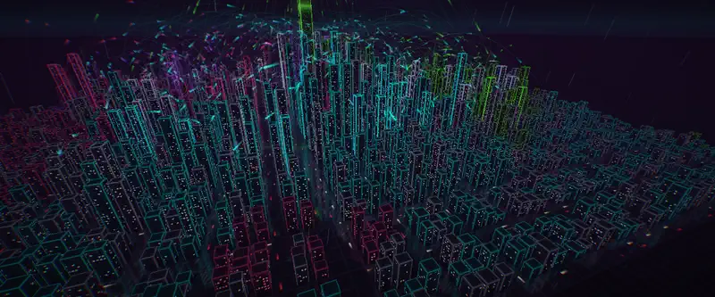

<h1 align="center">nightwire</h1>

<b>A rain-soaked city you can fly through, in one 49 KB HTML file.</b> 
Every building is a host. Every light is a packet. Click a building to scan it, 
and watch the city catch an intrusion live.

  <a href="https://maulanawirawan.github.io/nightwire/"><b>▶ Fly it live</b></a>
  ·
  <a href="index.html">read the source</a>

  

## What you're looking at

- **3,297 hosts.** Each tower is a procedurally generated building. They have lit windows, neon edges, and blinking aircraft lights.
- **Packets.** About 870 light streaks arc between rooftops. The green ones come from the core spire in the middle.
- **Wet streets.** It just rained, so the asphalt reflects the city. A mirrored render of the scene is blurred and rippled by falling raindrops. Headlights and tail lights run down every street.
- **The evidence ladder.** Clicking a building scans it, and the scan climbs `L0 OBSERVED → L1 SUSPECTED → L2 REPRODUCED → L3 VERIFIED ✓`. The building only turns green and fires a beam once the finding is proven. It's the same rule as [secai](https://github.com/maulanawirawan/secai): a finding you can't prove is a lead, not a claim.
- **Real detections.** Each verified scan resolves to a real CVE template I've had merged into [projectdiscovery/nuclei-templates](https://github.com/projectdiscovery/nuclei-templates). The list is pulled live from the GitHub API when the page loads, and the "last match" link opens the actual PR.
- **Intrusions.** Every 20 seconds or so, or whenever you press `X`, red traffic pours in from outside the city and converges on one host:
  1. The host blinks red and the screen edges pulse.
  2. The finding climbs the ladder.
  3. Once it's proven, the core spire fires back.
  4. The attack traffic is quarantined and a shockwave rolls across the streets.
- **Sound.** The drone, the rain, the alarms, and the scan chimes are all synthesized live with the Web Audio API.

## Controls

| | |
|---|---|
| drag | look around |
| `W A S D` / arrows | fly |
| `E` / `Q` | up / down |
| `Shift` | boost |
| scroll | flight speed |
| click | scan a building |
| `X` | launch an attack |
| `R` | rain on / off |
| `C` | back to the cinematic tour |
| `H` | hide the HUD |
| `M` | sound on / off |
| two-finger hold (touch) | fly forward |

Until you touch anything, the camera runs a cinematic tour that scans buildings and fends off attacks by itself.

## How it's built

There's one file, `index.html`. It has no libraries, no images, no models, and no audio files.

- **Rendering:** raw WebGL2, which runs on desktop and mobile browsers.
- **Buildings:** a single unit cube drawn 3,297 times with instancing. Windows, neon edges, the radar sweep, the alert state, and the verified state are all done in the fragment shader.
- **Wet streets:** the city is drawn a second time, mirrored, at half resolution. The ground samples that render with blur, a fresnel term, puddle noise, and procedural raindrop ripples.
- **Packets and attack traffic:** camera-facing ribbons positioned along their arcs in the vertex shader. Attack waves are one-shot arcs driven by a single "age" uniform.
- **Rain:** 2,600 streaks that wrap around the camera inside a box, also computed entirely on the GPU.
- **Glow:** an HDR scene buffer, then a two-level bloom, then a tone map, with a red alarm vignette during an intrusion.
- **Camera tour:** a closed Catmull-Rom spline, reparameterised by arc length so the speed stays constant. It is checked so it never clips a building.
- **Scan picking:** the click is a ray marched across the city grid on the CPU.
- **Quality:** resolution scales down on its own when the frame rate drops. Add `?q=low` to force it lower, or `?dry` to start without rain.

## Run it locally

Open `index.html` in a browser. There's no build step.

## License

MIT
